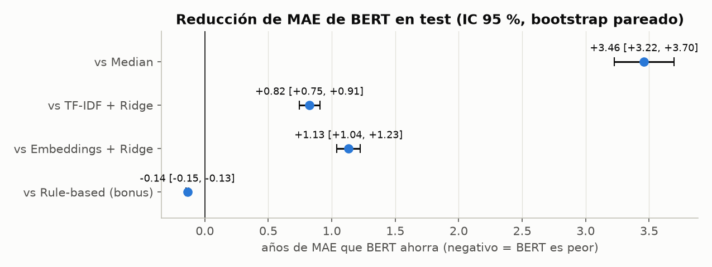
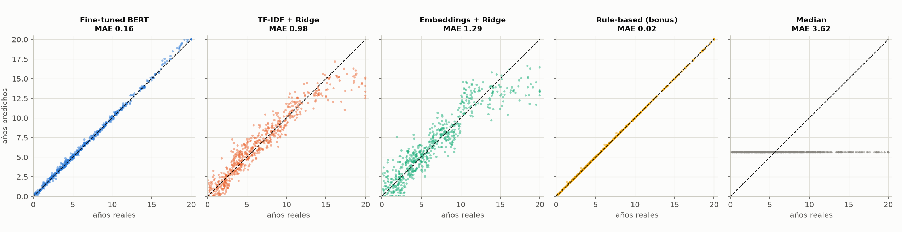
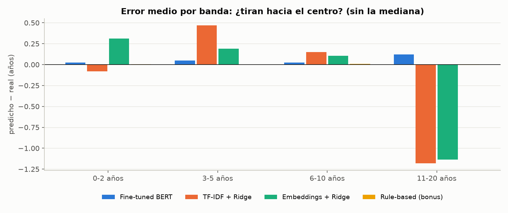
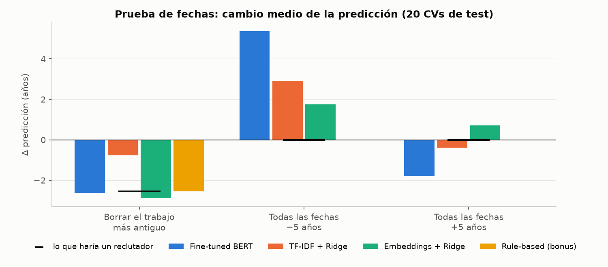
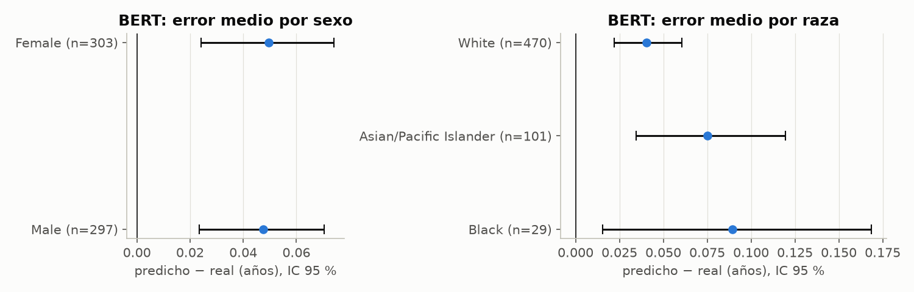

# cv_experience_ocr_bert

Sistema de document AI de punta a punta: lee la imagen de un CV, extrae el texto con
**PaddleOCR** y predice los **años de experiencia laboral (0–20)** del candidato con un
modelo **BERT** ajustado como regresor. Lo comparamos con tres baselines (mediana,
TF-IDF + Ridge y sentence embeddings + Ridge).

## 1. ¿Qué hace el proyecto y para quién?
El sistema recibe la **imagen** de un CV, la convierte en texto con PaddleOCR y estima los
**años de experiencia laboral** del candidato. Esa cifra casi nunca está escrita en el CV:
hay que deducirla de las fechas de cada trabajo, de cuántos puestos hay y de cuándo terminó
la formación.

Está pensado para equipos que procesan muchos CVs escaneados o en PDF:
- agencias de reclutamiento;
- portales de empleo;
- servicios públicos de empleo;
- áreas de RR. HH.

Su uso es **prellenar un perfil o ayudar a ordenar CVs**, nunca decidir a quién se
entrevista ni a quién se contrata (ver la Pregunta 4).

Comparamos cinco formas de estimar la experiencia sobre exactamente la misma partición:
- una mediana;
- TF-IDF + Ridge;
- sentence embeddings + Ridge;
- DistilBERT ajustado como regresor;
- como bonus, una regla que suma las fechas.

**Resultado en una línea:** BERT reduce el error de TF-IDF de 0.98 a **0.16 años**, una mejora
estadísticamente significativa. Pero una regla de 40 líneas que suma los periodos llega a
**0.02 años**. Además, la prueba de las fechas muestra que BERT aprendió un atajo propio de
este dataset.

## 2. Muestreo de CVs y distribución de la experiencia
**Dataset:** [PopResume](https://huggingface.co/datasets/sumin-yu/PopResume) (Yu, Park & Moon,
EMNLP 2026; CC BY 4.0), CVs sintéticos generados a partir de estadísticas de población de EE. UU.

**Muestreo** ([src/download_data.py](src/download_data.py)):
- Solo imágenes **sin foto** (`has_photo == False`).
- **800 CVs por ocupación, 4,000 en total**, con semilla **42**.
- Se hace en dos pasos. Primero se lee un índice liviano de los 43 shards (todas las columnas
  menos la imagen) y se sortean los CVs con `numpy.random.default_rng(42)`. Esto da un muestreo
  aleatorio **uniforme** sobre toda la población sin foto, sin depender del tamaño de un buffer de
  mezcla como en el streaming. Después se descarga cada shard, se extraen solo las imágenes
  sorteadas y el shard se borra.
- El `id` de PopResume se repite entre ocupaciones, así que la clave del proyecto es
  `cv_id = "<job>_<id>"`. Ningún CV tenía más de una imagen sin foto.
- Los IDs sorteados están en [data/raw/sampled_ids.csv](data/raw/sampled_ids.csv). Con ese
  archivo, o con la misma semilla, la muestra se reproduce exactamente.

| Ocupación | Población sin foto | Muestra | Media | Mediana | Máx. | CVs ≥ 20 años |
|---|---:|---:|---:|---:|---:|---:|
| Accountants & auditors | 7,784 | 800 | 7.27 | 6.24 | 25.6 | 11 |
| Construction laborers | 5,910 | 800 | 5.96 | 4.60 | 22.6 | 10 |
| Elementary / middle school teachers | 16,188 | 800 | 6.80 | 5.95 | 26.7 | 6 |
| Registered nurses | 17,632 | 800 | 6.46 | 5.63 | 24.0 | 2 |
| Software developers | 13,370 | 800 | 6.33 | 5.64 | 22.4 | 3 |
| **Total** | **60,884** | **4,000** | **6.56** | **5.66** | **26.7** | **32** |

**Target:** `exp_year`, los años de experiencia, que en el dataset es un valor continuo (por
ejemplo 3.44). Se recorta a **0–20**, y 20 se lee como "20 o más".

**Revisión del tope:** solo **32 CVs (0.8 %)** llegan a 20 años o más, muy por debajo del umbral
del 15 %. Por eso se **mantiene el tope en 20** para todos los modelos.

La distribución está sesgada a la derecha: la mediana es 5.7 años y hay pocos CVs senior. Por
eso esperamos que los modelos tiendan a "tirar hacia el centro", sobrestimando a los juniors y
subestimando a los seniors (ver la Pregunta 1).

Tabla completa: [output/tables/target_distribution.csv](output/tables/target_distribution.csv).

## 3. PaddleOCR: modelo, configuración y orden de lectura
**Versión y configuración** ([src/ocr_extraction.py](src/ocr_extraction.py)):
- PaddlePaddle 3.2.0 (GPU, CUDA 12.6) y PaddleOCR 3.2.0, en `lang="en"`.
- Se desactivaron la clasificación de orientación del documento, el *unwarping* y la
  orientación de líneas, porque las imágenes son escaneos limpios y derechos.
- PaddleOCR se ejecuta en un entorno aislado con Python 3.12 dentro de Colab, para no
  mezclar sus librerías CUDA con las de PyTorch.

**Elección del modelo.** El detector es `PP-OCRv5_server_det`. Para el reconocimiento
comparamos dos modelos sobre los mismos 40 CVs al azar:

| Reconocimiento | CER | WER | Seg/CV | Confianza |
|---|---:|---:|---:|---:|
| **`en_PP-OCRv5_mobile_rec`** (inglés) | **1.01 %** | **9.2 %** | **0.67** | **0.989** |
| `PP-OCRv5_server_rec` (multilingüe) | 1.05 % | 11.6 % | 0.89 | 0.982 |

Elegimos **`en_PP-OCRv5_mobile_rec`**. El CER es igual en los dos, pero el móvil tiene menos
errores de palabra (es un modelo específico para inglés) y es un 25 % más rápido. Su único
fallo sistemático es que a veces omite el guion de los rangos de fechas; lo reparamos en la
limpieza, ver la sección 5.

**Ejecución completa** ([output/metrics/ocr_summary.json](output/metrics/ocr_summary.json)):

| Métrica | Valor |
|---|---|
| Hardware | GPU Tesla T4 (Google Colab) |
| CVs procesados / fallidos | 4,000 / **0** |
| Tiempo de OCR por CV | **0.71 s** (≈ 0.95 s contando la lectura de la imagen y la escritura en Drive) |
| Tiempo total | 47 min |
| Confianza media | **0.989** (ninguna línea por debajo de 0.8) |
| Líneas por CV | 14.4 |

Cada CV se guarda en `data/ocr/<cv_id>.json` con el texto, la confianza y la caja
`[x1, y1, x2, y2]` de cada línea. El OCR se ejecuta una sola vez y después se reutiliza.

**Orden de lectura** (`reading_order`):
1. **Filas.** Las cajas se ordenan de arriba hacia abajo. Las que están a la misma altura
   (centros a menos de ½ altura de línea) se unen en una fila de izquierda a derecha, así un
   cargo no queda separado de unas fechas alineadas a la derecha. Un salto vertical grande
   abre un bloque nuevo.
2. **Dos columnas.** Se busca un "pasillo" vertical vacío en el 20–80 % central del ancho,
   de al menos 2 % del ancho. Para que cuente como pasillo, a cada lado tiene que quedar al
   menos el 15 % de las líneas, y ningún lado puede estar formado sobre todo por fechas: las
   fechas alineadas a la derecha dejan un hueco parecido, pero no son una columna. Las líneas
   que cruzan el pasillo, como un nombre centrado, actúan como separadores. Entre dos
   separadores se lee primero la columna izquierda completa y después la derecha.
3. **Pruebas.** La lógica se probó con un CV sintético de dos columnas y con uno de una
   columna con fechas a la derecha. En PopResume, **los 4,000 CVs usan una plantilla de una
   sola columna**: nombre, contacto, *Work History* y *Education*. Ninguno se detectó como de
   dos columnas, así que el orden de lectura no introduce errores en esta muestra.

## 4. Calidad del OCR (CER, WER, años leídos correctamente)
Calculado con [src/ocr_quality.py](src/ocr_quality.py) contra el texto de referencia del
dataset, que se usa **solo** para medir.

Ambos textos se normalizan igual: NFKC, minúsculas, todos los guiones como `-`, sin viñetas
ni `|`, y espacios colapsados. La versión "cruda" solo colapsa espacios.

| Ocupación | CER | WER | CER crudo | WER crudo | Años OK (crudo) | Años OK (reparado) | Rangos OK |
|---|---:|---:|---:|---:|---:|---:|---:|
| Accountants & auditors | 0.74 % | 3.4 % | 0.99 % | 9.4 % | 96.9 % | 99.96 % | 100 % |
| Construction laborers | 0.60 % | 2.7 % | 0.91 % | 8.5 % | 97.4 % | 100 % | 100 % |
| Teachers | 0.69 % | 3.1 % | 0.86 % | 7.9 % | 98.1 % | 99.94 % | 98.1 % |
| Registered nurses | 0.87 % | 4.2 % | 1.04 % | 9.4 % | 88.7 % | 100 % | 100 % |
| Software developers | 0.92 % | 4.4 % | 1.13 % | 10.3 % | 93.3 % | 99.94 % | 100 % |
| **Total** | **0.76 %** | **3.6 %** | 0.99 % | 9.1 % | **94.5 %** | **99.96 %** | **99.7 %** |

La mediana del CER es 0.74 % y el percentil 95, 1.16 %: la calidad es muy pareja entre CVs.

**Dónde falla el OCR** ([output/tables/ocr_top_word_errors.csv](output/tables/ocr_top_word_errors.csv)):
1. **Omite el guion de los rangos de fechas.** `2017.07–2020.04` se lee como
   `2017.072020.04` en **1,337 rangos de 1,111 CVs (28 %)**. Los dígitos son correctos, pero el
   año final queda pegado al anterior: sin reparar, solo se recupera el 94.5 % de los años. La
   limpieza lo repara de forma determinista y el porcentaje sube a 99.96 %.
2. **Confunde `I` con `l` en siglas:** `API→APl`, `UI→Ul`, `CI/CD→Cl/CD`. Afecta sobre todo a
   *software developers*, que es la ocupación con el CER más alto.
3. **Corta el último carácter en las líneas más largas:** `2023.01→2023.0`, en 32 CVs de
   *teachers*, cuyo nombre de ocupación y de escuela forman la línea más larga. Es la causa de
   su 98.1 % en rangos. El año sí se conserva; se pierde un dígito del mes.
4. **La confianza no predice el error:** la correlación entre la confianza media y el CER es
   **0.04**.

En total, **3,990 de los 4,000 CVs (99.75 %) tienen todos sus años correctos** después de
la reparación.

## 5. Limpieza del texto y enmascaramiento de respuestas directas
[src/preprocessing.py](src/preprocessing.py) genera `data/processed/cvs.csv`.

**Limpieza:**
- Normalización NFKC.
- Guiones `– — −` → `-`.
- **Reparación de rangos de fechas:** todos quedan como `AAAA.MM - AAAA.MM`; 1,337 rangos no
  tenían guion.
- Viñetas `•` → `- `, y se quita el espacio que deja una viñeta perdida por el OCR.
- Se unen las palabras cortadas con guion al final de línea y las líneas que continúan una
  frase.

**Líneas de baja confianza.** No se eliminan en el texto principal. Ninguna línea tiene
confianza menor que 0.8, y la confianza no se correlaciona con el error (r = 0.04): con un
umbral se borraría texto correcto sin ganar nada. Como variante para la Pregunta 3,
`text_clean_conf` elimina las líneas con confianza < 0.9: son 31 líneas en 31 CVs.

**Datos personales eliminados:**
- Email (4,000), teléfono (3,985) y ubicación `XX, USA` (4,000), que además es el estado,
  una variable prohibida.
- El nombre, que se busca solo en el encabezado: 8,000 apariciones.

Se verificó que en ningún CV queda texto antes de *Work History*, ni rastros de contacto
(`+`, `@`, `USA`). En los 15 CVs donde no se contó un teléfono, el OCR había pegado el teléfono
al email sin espacios (`...-9216|nombre@...`), y la regex del email eliminó ambos juntos.

**Respuestas directas.** Se buscan con regex:
- experiencia total ("12 years of experience", "Experience: 7 years");
- edad ("Age: 39", "34 years old");
- fecha de nacimiento ("Born in 1990", "DOB").

Las fechas de cada trabajo y los años de graduación **no** se tocan. Las regex se probaron
con frases de ejemplo y se leyeron **50 CVs al azar**
([output/tables/review_sample_50.txt](output/tables/review_sample_50.txt)). **Ningún CV contiene
estas frases: 0 CVs enmascarados.** La plantilla de PopResume no tiene sección de resumen.

**Hallazgo de la lectura manual.** `exp_year` coincide con la **suma de la duración de los
trabajos**, sin contar los periodos entre trabajos. Por ejemplo:
- 2020.01–2023.01 + 2015.03–2018.03 = 6.0 años, y `exp_year` = 6.00;
- un CV con un hueco entre 2009 y 2012 suma 4 × 3.5 = 14.04 años.

Todos los trabajos actuales terminan en 2023.01, así que la fecha de referencia del dataset
es enero de 2023. Esto hace que un modelo de reglas que sume los periodos sea un competidor
muy fuerte para BERT (ver la sección 7).

**Versiones del texto en `cvs.csv`:**

| Columna | Contenido | Uso |
|---|---|---|
| `text_raw` | OCR en orden de lectura, sin PII y con enmascarado | Pregunta 3 |
| `text_clean` | + limpieza | **Entrada de todos los modelos** |
| `text_clean_conf` | + sin líneas con confianza < 0.9 | Pregunta 3 |
| `text_ref` | Texto de referencia con la misma limpieza | Solo Pregunta 2 (nunca para entrenar) |

`sex` y `race` se conservan únicamente para el chequeo de equidad de la Pregunta 4. `age`,
`state`, `region` y los nombres no pasan a `cvs.csv`.

Un CV limpio tiene en promedio **516 caracteres y 65 palabras**, unos ~130 tokens de BERT,
así que cabe completo en 512 tokens.

## 6. Partición train / validation / test
[src/split.py](src/split.py) divide los CVs **por `cv_id`** en 70 / 15 / 15 %, con semilla 42,
**estratificando por ocupación × banda de experiencia**: 20 estratos con las bandas 0–2, 3–5,
6–10 y 11–20. Los IDs están en [data/splits/](data/splits/) y **todos los modelos usan
exactamente esta partición**.

| Split | CVs | Media de años | 0–2 | 3–5 | 6–10 | 11–20 |
|---|---:|---:|---:|---:|---:|---:|
| train | 2,800 | 6.54 | 563 | 801 | 908 | 528 |
| val | 600 | 6.50 | 121 | 171 | 195 | 113 |
| test | 600 | 6.67 | 121 | 172 | 194 | 113 |

Toda la selección de hiperparámetros usa **validation**. Los scripts de entrenamiento solo
imprimen métricas de validación; **el test se evalúa una única vez, al final** (sección 9).

## 7. Baselines
Todos predicen un número de años, que se recorta a [0, 20]. Usan `text_clean` como entrada
y se ajustan solo con validación.

| Modelo | Cómo funciona | Hiperparámetros elegidos en val |
|---|---|---|
| **Mediana** ([baseline_median.py](src/baseline_median.py)) | Predice siempre la mediana de train (5.64 años). No lee el texto. | — |
| **TF-IDF + Ridge** ([baseline_tfidf.py](src/baseline_tfidf.py)) | N-gramas de palabras con TF-IDF (`sublinear_tf`, `min_df=2`) + regresión Ridge | n-gramas 1–3, α = 0.001 |
| **Embeddings + Ridge** ([baseline_embeddings.py](src/baseline_embeddings.py)) | `all-MiniLM-L6-v2` **congelado** (384 dim., vectores normalizados) + Ridge | α = 0.01 |
| **Reglas (bonus)** ([baseline_rules.py](src/baseline_rules.py)) | Extrae los periodos `AAAA.MM – AAAA.MM` con regex, une los solapamientos y suma los meses. No se entrena. | — |

**Decisiones:**
- **Números en TF-IDF: se conservan.** El patrón de tokens `\b\w+\b` convierte
  `2018.12 - 2023.01` en `2018`, `12`, `2023`, `01`. TF-IDF no puede restar fechas, pero sí
  aprender que un año de inicio temprano o muchas líneas de cargo indican más experiencia. Sin
  dígitos, el MAE de validación empeora de **0.97 a 1.67 años**.
- **α de TF-IDF.** La búsqueda (α de 0.001 a 10, n-gramas de 1 a 3) es plana por debajo de
  α = 0.03: de 0.03 a 0.001 el MAE solo mejora 0.006 años. Con 2,800 CVs el modelo casi no
  necesita regularización.
- **CVs largos para el encoder.** MiniLM admite 256 tokens. El código parte los textos más
  largos en trozos de líneas completas de hasta 250 tokens, para no separar un cargo de sus
  fechas, y promedia los vectores ponderando por tokens. En la práctica **ningún CV lo
  necesitó**: la mediana es de 94 tokens y el máximo, 157.
- **Modelo de reglas.** Si el OCR corta un mes (`2023.0`), usa el mes 6. "Present" o
  "Current" se interpretan como la fecha de referencia del dataset, 2023.01.

**Resultados en validación** (los de test están en la sección 9):

| Modelo | MAE | RMSE | ±1 | ±2 | ±3 | R² |
|---|---:|---:|---:|---:|---:|---:|
| Mediana | 3.61 | 4.62 | 15.5 % | 31.2 % | 49.0 % | −0.04 |
| TF-IDF sin dígitos | 1.67 | 2.34 | 42.7 % | 70.7 % | 85.5 % | 0.74 |
| Embeddings + Ridge | 1.28 | 1.71 | 49.8 % | 79.3 % | 93.3 % | 0.86 |
| TF-IDF + Ridge | 0.97 | 1.31 | 62.7 % | 91.2 % | 96.5 % | 0.92 |
| **Reglas** | **0.023** | **0.045** | **100 %** | **100 %** | **100 %** | **1.00** |

El modelo de reglas se equivoca en promedio **~1 semana**. Esto confirma que `exp_year` es
la suma de los periodos de trabajo; el error restante viene de que las fechas del CV están en
meses y el dataset calcula con días. TF-IDF le gana a los embeddings porque los embeddings de
frases resumen el *tema* del texto y prácticamente ignoran los dígitos de las fechas.

**¿Qué usa TF-IDF?** ([output/tables/top_features_tfidf.csv](output/tables/top_features_tfidf.csv))
Usa dos tipos de pista, y ninguna es una resta:
1. **Los años como palabras sueltas.** `2008`, `2009`, `2010`… tienen los coeficientes más
   positivos, y `2020`, `2021`, `2022` los más negativos. El modelo detecta *cuándo empezó* la
   carrera, pero no calcula duraciones ni descuenta los huecos entre trabajos.
2. **La progresión del lenguaje.** Los verbos de responsabilidad (*designed, directed, managed,
   led*) suben la predicción. Las palabras de formación (*studied, coursework*), típicas de CVs
   cortos con más peso de la educación, la bajan.

## 8. BERT como regresor
[src/train_bert.py](src/train_bert.py) ajusta **`distilbert-base-uncased`** (66 M de
parámetros). Elegimos DistilBERT porque es el más ligero de la lista, entrena en minutos en
una T4 y su tokenizador WordPiece separa bien los números (`2018`, `.`, `12`).

**Configuración de la regresión:**
- Una sola salida:
  `AutoModelForSequenceClassification.from_pretrained(..., num_labels=1, problem_type="regression")`.
- Pérdida MSE.
- Target escalado (`y / 20`) durante el entrenamiento; las predicciones se multiplican por 20
  y se recortan a [0, 20].

**CVs largos.** Con el tokenizador de DistilBERT, los CVs limpios tienen una mediana de
**96 tokens** y un máximo de **159**. Con `max_length=256` **ningún CV se trunca (0 de 2,800)**:
no hace falta *head + tail* ni *chunking*, y todas las fechas llegan al modelo.

**Hiperparámetros.** El learning rate se eligió en validación (15 épocas, paciencia 3):

| Learning rate | Mejor MAE val | Comentario |
|---|---:|---|
| **5e-5** | **0.165** | Seguía mejorando en la última época |
| 2e-5 | 0.242 | *Early stop* en la época 14 |
| 3e-5 | 0.362 | *Early stop* en la época 7 |

El MAE de validación es ruidoso mientras el learning rate es alto (oscila ±0.1 entre
épocas) y converge cuando el *scheduler* lineal lo baja a 0. Por eso la configuración final
usa 20 épocas y *early stopping* con paciencia 5: corta si deja de mejorar, pero no por una
oscilación.

| Parámetro | Valor |
|---|---|
| Learning rate | 5e-5, *warmup* lineal del 10 % y decaimiento lineal a 0 |
| Batch size | 16 (evaluación: 64) |
| Épocas | máximo 20, *early stopping* sobre el MAE de validación (paciencia 5); se restaura el mejor *checkpoint* |
| Weight decay | 0.01 |
| Max length | 256 |
| Precisión | fp16 |
| Semilla | 42 |
| Hardware | GPU Tesla T4 (Google Colab) |
| Tiempo de entrenamiento | **264 s (4.4 min)** |

**Resultados en validación** (variantes para la Pregunta 3):

| Variante | MAE val | RMSE | R² |
|---|---:|---:|---:|
| **MSE, texto limpio (modelo principal)** | **0.160** | 0.233 | 0.997 |
| Huber (δ = 1 año), texto limpio | 0.130 | 0.186 | 0.998 |
| MSE, OCR crudo | 0.150 | 0.224 | 0.998 |
| MSE, sin líneas con confianza < 0.9 | 0.142 | 0.203 | 0.998 |

Las diferencias entre variantes (≤ 0.03 años) son del mismo orden que la oscilación del MAE
de validación entre épocas. Con una sola semilla por variante **no se pueden considerar
diferencias reales**. El modelo principal sigue siendo el de MSE, la pérdida que pide el
enunciado; Huber se discute en la Pregunta 3.

Los pesos no se suben a GitHub. Se regeneran con `python -m src.train_bert` y quedan en
`models/bert/bert/`.

## 9. Métricas finales y ganancia de BERT
Todo se evaluó **una sola vez en test** (600 CVs), con [src/evaluation.py](src/evaluation.py)
`--final`. Las figuras se generan con [src/visualization.py](src/visualization.py).

[output/tables/model_comparison.csv](output/tables/model_comparison.csv):

| Model | MAE (years) | RMSE (years) | Acc ±1 | Acc ±2 | Acc ±3 | Band accuracy | Band macro-F1 | R² | Training time | Inference time per CV |
|---|---:|---:|---:|---:|---:|---:|---:|---:|---:|---:|
| Median | 3.620 | 4.706 | 16.5 % | 34.0 % | 49.8 % | 32.3 % | 0.122 | −0.050 | 0.0 s | 0.00 ms |
| TF-IDF + Ridge | 0.984 | 1.401 | 64.5 % | 90.5 % | 95.7 % | 84.0 % | 0.848 | 0.907 | 0.5 s | 0.12 ms |
| Embeddings + Ridge | 1.293 | 1.763 | 51.5 % | 80.2 % | 92.0 % | 79.7 % | 0.802 | 0.853 | 5.0 s | 1.72 ms |
| **Fine-tuned BERT** | **0.161** | **0.219** | **100 %** | **100 %** | **100 %** | **95.3 %** | **0.953** | **0.998** | 264.3 s | 1.30 ms |
| Rule-based (bonus) | 0.024 | 0.042 | 100 % | 100 % | 100 % | 99.2 % | 0.992 | 1.000 | 0.0 s | 0.01 ms |

Los tiempos de inferencia son por CV en lote, en una GPU T4, sin contar el OCR (0.71 s por
CV). El tiempo de entrenamiento de los embeddings incluye codificar el set de entrenamiento.

**Ganancia de BERT.** Es la reducción de MAE (baseline − BERT), con un IC 95 % por bootstrap
**pareado** de 2,000 remuestreos sobre los mismos CVs de test
([bert_gain_bootstrap.csv](output/tables/bert_gain_bootstrap.csv)):

| BERT vs | Reducción de MAE | IC 95 % | ¿Significativa? |
|---|---:|---|---|
| Median | **+3.46 años** | [+3.22, +3.70] | Sí |
| TF-IDF + Ridge | **+0.82 años** | [+0.75, +0.91] | Sí |
| Embeddings + Ridge | **+1.13 años** | [+1.04, +1.23] | Sí |
| Rule-based (bonus) | **−0.14 años** | [−0.15, −0.13] | Sí: **BERT es peor** |

**Predicho vs real** (la línea punteada es la de 45°):

**MAE por banda de experiencia real** ([mae_by_band.csv](output/tables/mae_by_band.csv)):

| Modelo | 0–2 (n=121) | 3–5 (n=172) | 6–10 (n=194) | 11–20 (n=113) |
|---|---:|---:|---:|---:|
| Median | 4.11 | 1.63 | 2.18 | 8.61 |
| TF-IDF + Ridge | 0.74 | 0.89 | 0.83 | **1.66** |
| Embeddings + Ridge | 1.13 | 0.97 | 1.10 | **2.31** |
| Fine-tuned BERT | 0.14 | 0.17 | 0.15 | 0.20 |
| Rule-based | 0.02 | 0.02 | 0.03 | 0.02 |

**¿Tiran hacia el centro?** Sí, los baselines:
- TF-IDF y los embeddings **subestiman a los seniors en ~1.2 años** (error medio −1.18 y −1.14
  en 11–20).
- Y sobrestiman a los CVs de 0–5 años (hasta +0.47).
- BERT no muestra ese patrón: su sesgo es pequeño y positivo en todas las bandas (+0.02 a
  +0.12).

**MAE por ocupación** ([mae_by_occupation.csv](output/tables/mae_by_occupation.csv)):

| Modelo | Accountants | Construction | Teachers | Nurses | Software dev. |
|---|---:|---:|---:|---:|---:|
| TF-IDF + Ridge | 0.98 | 0.97 | 0.99 | 0.96 | 1.02 |
| Embeddings + Ridge | 1.25 | 1.19 | 1.31 | 1.23 | 1.48 |
| Fine-tuned BERT | 0.18 | 0.15 | 0.14 | 0.18 | 0.16 |
| Rule-based | 0.02 | 0.02 | 0.03 | 0.02 | 0.02 |

Ninguna ocupación es claramente más difícil. *Software developers* es la peor para los
embeddings, coherente con que es la ocupación con más errores de OCR en siglas (`APl`,
`Ul`).

Las matrices de confusión por bandas están en `output/figures/confusion_<modelo>.png`.

**Los 10 mayores errores de BERT** ([bert_top10_errors.csv](output/tables/bert_top10_errors.csv)):
- Los 10 son **sobrestimaciones**, de +0.68 a +0.93 años.
- En los 10, las fechas del OCR **coinciden exactamente con la referencia**, así que el OCR
  no es la causa.

| Causa | CVs | Detalle |
|---|---:|---|
| **Hueco entre trabajos** | 7 | Huecos de 0.8 a 2.4 años. BERT cuenta parte del hueco como experiencia (ver la prueba de fechas, Pregunta 1). |
| **Otra: carrera larga y continua cerca del tope** | 3 | 18–19 años con 4 trabajos sin huecos, en la banda con menos datos (11–20). |
| OCR leyó mal una fecha / orden de lectura / solapamiento / fechas faltantes / truncamiento | 0 | No aparecen: el OCR es correcto, la plantilla tiene una columna, no hay solapamientos y ningún CV supera 256 tokens. |

**Posibles mejoras:**
1. **Darle a BERT las duraciones ya calculadas:** por ejemplo, agregar al texto
   "periodo: 3.2 años" junto a cada trabajo, o combinar BERT con la suma de fechas en un
   modelo híbrido.
2. **Aumento de datos con fechas desplazadas,** para romper el atajo "2023 = hoy".
3. **Promediar varias semillas** o hacer *ensembles*, porque el MAE de validación es ruidoso.
4. **Más CVs senior,** que es la banda más escasa.

## 10. Preguntas analíticas
### Pregunta 1 — ¿Qué aprende BERT que los baselines no pueden?
**¿Cuánto mejora?** BERT reduce el MAE en **3.46 años frente a la mediana, 0.82 frente a
TF-IDF y 1.13 frente a los embeddings**. Todas las mejoras son estadísticamente
significativas: los IC 95 % por bootstrap pareado excluyen el 0. Pasa de ~90 % a **100 %
de CVs dentro de ±2 años**.

**¿De dónde viene la ganancia?** Sobre todo de los **seniors**. En la banda 11–20, el MAE
baja de 1.66 (TF-IDF) a **0.20**, una ganancia de 1.46 años. En las demás bandas la ganancia
es de 0.6–0.7 años. Los baselines no pueden *restar* fechas:
- **TF-IDF** usa los años como palabras sueltas (`2008` → más experiencia, `2021` → menos) y
  la progresión del vocabulario (*directed, managed* → senior).
- **Los embeddings** resumen el tema del CV y casi ignoran los dígitos.

Por eso ambos comprimen las predicciones hacia la media y fallan más en los extremos.

**Prueba de las fechas** ([src/probe.py](src/probe.py), 20 CVs de test con ≥ 2 trabajos,
[q1_probe_summary.csv](output/tables/q1_probe_summary.csv)):

| Cambio en el CV | Lo que haría un reclutador | BERT | TF-IDF | Embeddings | Reglas |
|---|---:|---:|---:|---:|---:|
| Borrar el trabajo más antiguo | −2.55 | **−2.63** | −0.77 | −2.89 | −2.55 |
| Todas las fechas −5 años | 0 | **+5.38** | +2.92 | +1.75 | 0 |
| Todas las fechas +5 años | 0 | −1.79 | −0.38 | +0.72 | 0 |

**Qué nos dice:**
- **Al borrar un trabajo, BERT reacciona como un reclutador:** resta casi exactamente su
  duración (desviación media de 0.17 años). TF-IDF apenas se mueve (−0.77), porque para él
  borrar un trabajo es perder unas cuantas palabras. BERT **sí lee las fechas**.
- **Al desplazar todas las fechas, la experiencia real no cambia, pero BERT sí.** Hacia el
  pasado, BERT suma **+5.4 años**. En el entrenamiento todos los trabajos actuales terminan en
  2023.01, así que BERT aprendió algo como "**2023 − año de inicio − huecos**" en lugar de
  "fin − inicio": usa 2023 como un "hoy" fijo. Hacia el futuro el efecto es menor y errático
  (−1.8), porque son años que nunca vio.
- **Conclusión:** BERT lee y combina las fechas, algo que los baselines no hacen, pero se
  apoya en una regularidad de este dataset que no se cumpliría con CVs escritos en otro año.
  La regla que suma periodos es inmune a ese cambio.

### Pregunta 2 — ¿Cuánto cuesta el ruido del OCR?
**Calidad del OCR** (sección 4):
- CER **0.76 %** y WER **3.6 %**.
- Años bien leídos: **94.5 %** en crudo y **99.96 %** tras reparar los rangos sin guion.
- Falla en tres cosas: omite el guion de `AAAA.MM–AAAA.MM` (28 % de los CVs), confunde `I`/`l`
  en siglas (`APl`, `Ul`) y corta el último carácter de las líneas más largas (32 CVs de
  *teachers*).

**Mismo modelo, mismos CVs de test, con el texto del OCR y con el texto de referencia**
([q2_ocr_vs_reference.csv](output/tables/q2_ocr_vs_reference.csv)):

| Modelo | MAE con OCR | MAE con referencia | Brecha (OCR − ref.) |
|---|---:|---:|---:|
| Median | 3.620 | 3.620 | 0.000 |
| TF-IDF + Ridge | 0.984 | 0.984 | +0.001 |
| Embeddings + Ridge | 1.293 | 1.301 | −0.008 |
| Fine-tuned BERT | 0.161 | 0.161 | −0.001 |
| Rule-based | 0.024 | 0.021 | +0.003 |

**El ruido del OCR, después de la limpieza, prácticamente no cuesta nada:** las brechas son
≤ 0.008 años, menos de 3 días. Hay dos razones:
1. Los errores del OCR casi nunca tocan los dígitos.
2. El único error que sí afecta a las fechas (el guion perdido) se repara de forma
   determinista.

El más "sensible" es el modelo de reglas (+0.003), porque es el único que usa cada mes
exacto: en los 32 CVs con el mes cortado (`2023.0`) asume el mes 6. Los modelos aprendidos
son robustos porque reparten la información entre muchos tokens redundantes (año de inicio,
número de líneas, vocabulario), y BERT además ve los dígitos en piezas, así que tolera el
guion faltante.

Sin la limpieza, el costo sí se nota en los baselines (Pregunta 3): +0.05 años en TF-IDF y
+0.09 en los embeddings.

### Pregunta 3 — Sensibilidad metodológica
Se probaron tres decisiones ([q3_sensitivity.csv](output/tables/q3_sensitivity.csv), MAE en
test). Cada modelo se reentrenó con cada versión del texto.

**Limpieza del OCR:**

| Modelo | OCR crudo | **OCR limpio** (base) | Limpio sin líneas con conf. < 0.9 |
|---|---:|---:|---:|
| TF-IDF + Ridge | 1.032 | **0.984** | 0.985 |
| Embeddings + Ridge | 1.385 | **1.293** | 1.293 |
| Fine-tuned BERT | 0.139 | 0.161 | 0.137 |
| Rule-based | 0.024 | 0.024 | 0.024 |

**Otras dos decisiones:**

| Decisión | Configuración base | Alternativa |
|---|---|---|
| Números en TF-IDF | conservar dígitos: **0.984** | quitar dígitos: 1.829 (+86 %) |
| Pérdida de BERT | MSE: 0.161 | Huber (δ = 1 año): **0.123** |

- **La limpieza ayuda a los baselines** (−0.05 y −0.09 años). Sin reparar el guion,
  `2018.032020.08` es un token raro y los años dejan de verse como tokens separados.
- **A las reglas les da igual**, porque su regex ya tolera el guion faltante.
- **Filtrar por confianza no cambia nada:** solo elimina 31 líneas, y la confianza no se
  correlaciona con el error (r = 0.04).
- **Para BERT, las tres versiones quedan entre 0.137 y 0.161.** Es el mismo orden de magnitud
  que la oscilación del MAE de validación entre épocas (±0.05), así que con una sola semilla
  no se puede afirmar que el texto crudo sea mejor. Lo mismo pasa con Huber frente a MSE
  (−0.04): es prometedor, porque Huber es menos sensible a los CVs con huecos que generan los
  errores grandes, pero necesitaría varias semillas para confirmarlo.
- **Los dígitos son la decisión que más pesa:** sin ellos, TF-IDF casi duplica su error.

### Pregunta 4 — Valor de negocio, equidad y ética
**¿Quién lo usaría y para qué?**
- **Portales de empleo y agencias:** *prellenar* el campo "años de experiencia" de un perfil
  a partir de un CV escaneado, para que el candidato lo confirme.
- **Servicios públicos de empleo:** ordenar y agrupar grandes volúmenes de CVs en papel para
  derivarlos a programas según la trayectoria.
- **Áreas de RR. HH.:** detectar inconsistencias, por ejemplo cuando la experiencia declarada
  no coincide con la que se deduce de las fechas.

Prellenar un dato que una persona revisa es muy distinto de **filtrar automáticamente** quién
pasa a entrevista. Para esto último el sistema no debe usarse.

**¿Qué cuesta un error?**
- **±2 años** cambia la banda junior/semi-senior. Al prellenar un perfil es una molestia que
  el candidato corrige. En un filtro por requisito ("≥ 5 años") puede dejar fuera a alguien
  que sí cumple.
- **±5 años** confunde a un junior con un senior: ofertas equivocadas, rangos salariales mal
  sugeridos y pérdida de confianza en la herramienta.
- **Subestimar** es peor para el candidato, porque lo descarta en silencio y nadie revisa ese
  error. **Sobrestimar** es más visible: el reclutador lo detecta en la entrevista, aunque le
  hace perder tiempo y puede llevar a una contratación desajustada. Por eso, si el sistema se
  usara para ordenar CVs, convendría penalizar más la subestimación o mostrar siempre un
  intervalo.
- En test, BERT nunca se equivoca en más de 1 año. TF-IDF se equivoca en más de 2 años en el
  9.5 % de los CVs.

**Chequeo de equidad** de BERT en test ([q4_fairness_sex.csv](output/tables/q4_fairness_sex.csv),
[q4_fairness_race.csv](output/tables/q4_fairness_race.csv)). El error medio es predicho − real,
con IC 95 % por bootstrap:

| Grupo | n | MAE | Error medio | IC 95 % |
|---|---:|---:|---:|---|
| Female | 303 | 0.164 | +0.050 | [+0.024, +0.074] |
| Male | 297 | 0.157 | +0.048 | [+0.023, +0.070] |
| White | 470 | 0.159 | +0.040 | [+0.022, +0.061] |
| Asian/Pacific Islander | 101 | 0.164 | +0.075 | [+0.035, +0.120] |
| Black | 29 | 0.175 | +0.089 | [+0.015, +0.169] |

**Cómo leerlo:**
- **BERT sobrestima levemente a todos los grupos,** en +0.04 a +0.09 años (2 a 5 semanas).
- **Por sexo no hay diferencia:** +0.050 frente a +0.048.
- **Por raza,** el error medio es algo mayor para los grupos Asian/Pacific Islander y Black,
  pero los intervalos se solapan con el de White, y el grupo Black tiene solo 29 CVs. Con este
  tamaño no hay evidencia de un sesgo sistemático, y en cualquier caso la magnitud es de
  semanas.
- **Explicación plausible,** aunque sexo y raza no son entradas del modelo: los CVs de esos
  grupos tienen **más años de experiencia en promedio** en esta muestra (7.3–7.5 frente a 6.5),
  es decir, más trabajos y más probabilidad de huecos. Y los huecos son justamente lo que BERT
  sobrestima (Pregunta 1). Un sesgo puede entrar por variables correlacionadas, como la
  trayectoria, sin que el atributo sea un feature.
- **Muestra pequeña:** el split de test contiene solo tres grupos raciales y no permite
  analizar intersecciones (sexo × raza).

**Límites éticos.** El sistema estima un número a partir de fechas. No mide calidad, logros
ni potencial, y hereda los sesgos de cómo se escriben los CVs. Los huecos de carrera, que
afectan más a quienes cuidan a otros, a migrantes o a personas que estuvieron enfermas, son
justamente donde más se equivoca. **Nunca debe decidir quién es contratado ni descartar CVs
de forma automática.** Como mucho, puede prellenar un dato que una persona revisa, con el CV
original siempre a la vista.

## 11. Limitaciones y aplicaciones de negocio
**Limitaciones:**
- **CVs sintéticos con una sola plantilla.** Todas las imágenes de PopResume comparten el
  mismo diseño de una columna y las mismas fuentes, y `exp_year` es exactamente la suma de los
  periodos. Por eso el OCR es casi perfecto y una regla resuelve el problema. Con CVs reales
  (varios diseños, dos columnas, fotos de baja calidad, fechas como "Jan 2019 – present" o
  "2 años"), el OCR y el orden de lectura serían el cuello de botella, y la ventaja de un
  modelo aprendido frente a una regla sería mayor.
- **Fecha de referencia fija.** Todos los trabajos actuales terminan en 2023.01 y BERT aprendió
  a usar ese "hoy" (Pregunta 1). Habría que reentrenarlo o aumentar los datos antes de usarlo
  con CVs de otro año.
- **Solo 5 ocupaciones,** basadas en estadísticas de EE. UU. y **solo en inglés**. No sabemos
  cómo se comporta con otros sectores, países o idiomas.
- **4,000 CVs y una sola semilla por configuración.** Las diferencias pequeñas entre variantes
  de BERT (≤ 0.04 años) no son concluyentes.
- **El chequeo de equidad tiene poca potencia** para los grupos pequeños y no cubre
  intersecciones.

**Aplicaciones y recomendación de despliegue:**
- **Recomendación:** para documentos como estos, lo más costo-efectivo es **OCR + la regla que
  suma fechas**. Es ~7 veces más precisa que BERT, explicable, no necesita GPU para la
  inferencia y no depende del año de referencia.
- **BERT vale la pena cuando las fechas no siguen un formato fijo.** Si los CVs son
  heterogéneos, el valor de BERT está en *leer* textos variados, y lo ideal sería un sistema
  híbrido: BERT o un extractor de entidades encuentra los periodos, y una regla los suma.
- **En cualquier caso, el resultado es un dato de apoyo:** se muestra junto al CV para que una
  persona lo confirme.

## 12. Cómo reproducir el proyecto
El pipeline pesado (descarga, OCR y BERT) se ejecuta en **Google Colab con GPU** usando
[notebooks/colab_pipeline.ipynb](notebooks/colab_pipeline.ipynb). Las imágenes y los pesos
de los modelos no se suben a GitHub; se regeneran con los scripts de `src/`.

**Preparación (una vez):**
1. Crear una cuenta en Hugging Face, abrir la página del dataset
   [sumin-yu/PopResume](https://huggingface.co/datasets/sumin-yu/PopResume) y aceptar
   sus condiciones de acceso.
2. Crear un token de acceso (lectura) y guardarlo en Colab → 🔑 *Secrets* con el nombre
   `HF_TOKEN`.
3. Abrir el notebook en Colab y elegir *Runtime → T4 GPU*. La celda de configuración monta
   Google Drive y define `CV_STORAGE_DIR`, así que `data/`, `models/` y `output/` se guardan
   en `MyDrive/cv_experience_ocr_bert`.

**Pipeline**, en el orden de las celdas del notebook. Los tiempos son en una T4:

| Paso | Comando | Tiempo | Produce |
|---|---|---|---|
| 1. Muestreo | `python -m src.download_data` | 21 min | `data/raw/` (imágenes, metadata, texto de referencia, `sampled_ids.csv`) |
| 2. OCR | `python -m src.ocr_extraction` (en el entorno aislado de PaddleOCR) | 47 min | `data/ocr/<cv_id>.json` |
| 3. Calidad del OCR | `python -m src.ocr_quality` | 1 min | tablas `ocr_quality_*` |
| 4. Limpieza | `python -m src.preprocessing` | 3 min | `data/processed/cvs.csv` |
| 5. Partición | `python -m src.split` | segundos | `data/splits/{train,val,test}.csv` |
| 6. Baselines | `python -m src.baseline_median` / `baseline_rules` / `baseline_tfidf [--no-digits]` / `baseline_embeddings` | 2 min | `models/baselines/`, predicciones |
| 7. BERT | `python -m src.train_bert [--loss huber] [--text-col ...]` | 5–9 min por corrida | `models/bert/<nombre>/`, predicciones |
| 8. Prueba de fechas | `python -m src.probe` | 2 min | `q1_probe_*.csv` |
| 9. Evaluación final | `python -m src.evaluation --final` | segundos | todas las tablas de las secciones 9–10 |
| 10. Figuras | `python -m src.visualization` | segundos | `output/figures/` |

- Cada script acepta `--help`.
- Las variantes de la Pregunta 3 se obtienen con `--text-col text_raw` y
  `--text-col text_clean_conf`.
- La semilla es 42 en todo el pipeline.
- Las imágenes, los JSON del OCR y los pesos de los modelos no están en GitHub
  (`.gitignore`): se regeneran con los pasos 1, 2, 6 y 7.
- Los pasos 3–10 también se pueden ejecutar en local, si existen `data/` y `models/`.
- Instalación local: ver `requirements.txt`. PaddlePaddle se instala primero desde su propio
  índice; el comando está al inicio de ese archivo.

## 13. Cómo ejecutar la app de Streamlit
_Pendiente (Fase 7)._
